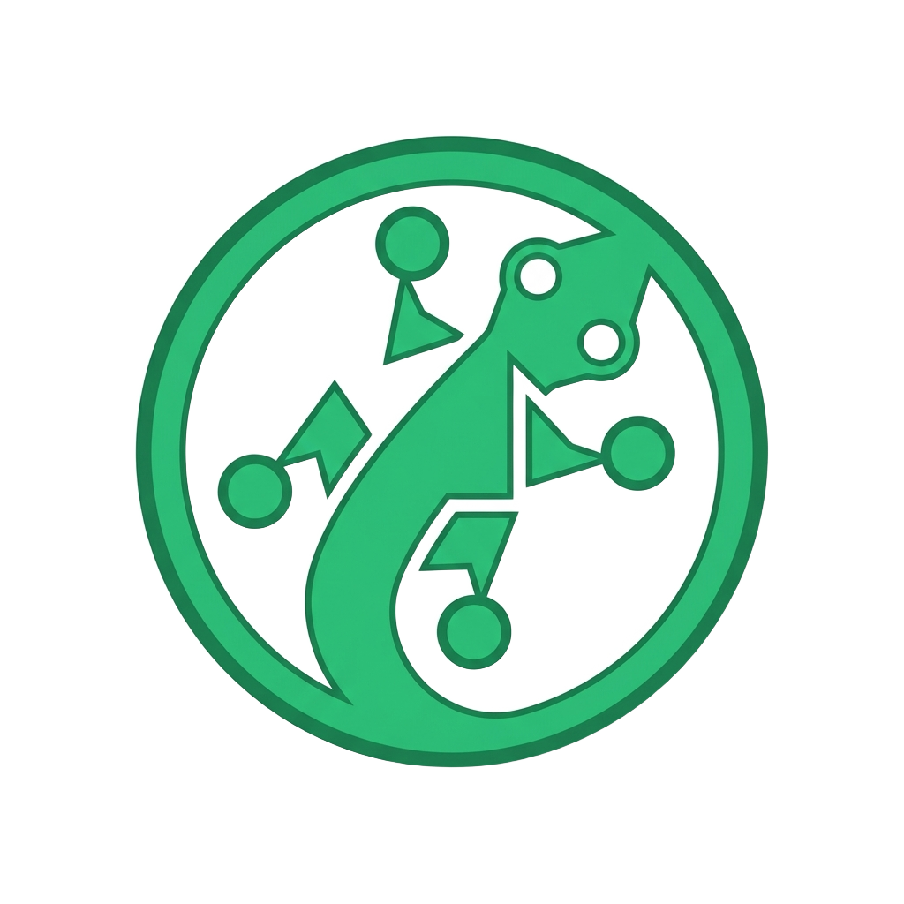

<p align="center">
  
</p>

<h1 align="center">Lizard LLM Community Edition</h1>

<p align="center">
  Run large language models on your own Windows PC, fully offline.<br />
  Two open-source inference engines, an Ollama-style CLI, a guided setup in the browser,<br />
  and an OpenAI- and Ollama-compatible API on <code>127.0.0.1</code>.
</p>

<p align="center">
  <a href="LICENSE"></a>
  
  
  
</p>

---

## What it does

- **Checks your machine** (processor, memory, graphics card) and only suggests models that will actually run on it.
- **Downloads GGUF models** from Hugging Face and verifies each file against its published SHA-256 before using it. It can also reuse models Ollama already has, without a second download.
- **Runs them on its own engines**: `lizard-native` (Direct3D 12, weights stay resident on the GPU) and `caterpillar` (pre-planned compute graph with speculative decoding). Both are in this repository as C++ source.
- **Serves a local API** that speaks OpenAI (`/v1/chat/completions`) and Ollama (`/api/chat`), so most existing tools and SDKs work without changes.
- **Stays on your computer.** No account, no telemetry, no licence check. Error reports are written to a local folder and never sent anywhere.

## Quick start

You need **Windows 10 or 11 (x64)**, **[Node.js 22+](https://nodejs.org)** and **Git**.

```powershell
git clone https://github.com/gerrywalter-ai-engineering/lizard-llm-community.git
cd lizard-llm-community
.\install.cmd
```

`install.cmd` checks Node.js, downloads the prebuilt engines from this repository's [GitHub release](https://github.com/gerrywalter-ai-engineering/lizard-llm-community/releases), verifies their checksum, and then offers to start the app. Next time, just run:

```powershell
.\start.cmd
```

The browser opens at <http://127.0.0.1:7818> and walks you through four steps:

1. **Your machine.** A hardware scan and a plain-language verdict on what fits.
2. **Pick a model.** A curated list ranked by fit, or a search across all GGUF models on Hugging Face.
3. **Download.** Choose an engine, then download with live progress, speed and time left. The file is verified before it is used.
4. **Chat and API.** Talk to the model, see tokens per second and time to first word, and copy a ready-made `curl` or SDK snippet.

## Command line

The CLI follows Ollama's verbs, so it feels familiar. Use `node src\cli.js <command>`, or run `npm link` once to get a global `lizard` command.

```powershell
lizard pull bartowski/Qwen2.5-1.5B-Instruct-GGUF   # picks the Q4_K_M file automatically
lizard run                                         # interactive chat with the active model
lizard run --engine caterpillar "Explain KV caching in two sentences"
lizard list
lizard serve                                       # API on http://127.0.0.1:8013
```

| Command | What it does |
| --- | --- |
| `lizard pull <owner/repo> [file.gguf]` | Download and verify a GGUF from Hugging Face. `--quant Q5_K_M` picks another size; `--activate` makes it the active model. |
| `lizard pull ollama:<tag>` | Import a model Ollama already has on this PC (hard link, no second download). |
| `lizard run [model] [prompt]` | Chat in the terminal, or answer one prompt and exit. `/clear` forgets the conversation, `/bye` quits and unloads the model. |
| `lizard list` / `ls` | Models on this machine. |
| `lizard show [model]` | Source, file, quantization, architecture, context length, licence and checksum. |
| `lizard ps` | The model that is loaded right now. |
| `lizard stop` | Unload it. |
| `lizard rm <model>` | Delete a downloaded model. |
| `lizard serve [model]` | Start the API server. `--engine caterpillar` (port 8014), `--port`, `--cpu-only`. |
| `lizard app` | Open the guided setup in the browser. |
| `lizard scan` / `lizard recommend` | Hardware profile and a model, context and offload recommendation. |
| `lizard engines` | What the two engines are and when to use which. |
| `lizard pro` | What the paid app adds. |

`lizard help` lists everything, including the lower-level `models`, `model` and `generate` commands.

## Use it from your own code

While a model is loaded (in the app, or with `lizard serve`), the engine answers on `127.0.0.1` only.

**curl**

```bash
curl http://127.0.0.1:8013/v1/chat/completions \
  -H "Content-Type: application/json" \
  -d '{"model": "active", "messages": [{"role": "user", "content": "Hello"}], "stream": true}'
```

**OpenAI SDK (Python)**

```python
from openai import OpenAI

client = OpenAI(base_url="http://127.0.0.1:8013/v1", api_key="local")
reply = client.chat.completions.create(
    model="active",
    messages=[{"role": "user", "content": "Write a haiku about lizards"}],
)
print(reply.choices[0].message.content)
```

**Ollama clients** point at `http://127.0.0.1:8013` and use `/api/chat` (plus `/api/tags`, `/api/ps`, `/api/version`).

Also available: `/v1/completions`, `/v1/models`, `/v1/responses`, `/health`, `/tokenize`, `/detokenize`.

## The two engines

| | `lizard-native` (default) | `caterpillar` |
| --- | --- | --- |
| Idea | Weights stay resident on the GPU between calls | The whole decode step is planned once as a compute graph, then replayed |
| GPU | Direct3D 12: NVIDIA, AMD and Intel, including integrated graphics (UMA zero-copy path) | Direct3D 12 with recorded command lists |
| CPU | Pinned ggml CPU backend, built in three variants (baseline, AVX2, AVX-512) and picked at runtime | Own CPU path with AVX2/AVX-512 kernels |
| Extras | Fused kernels, prefix cache, paged KV blocks, on-disk shader cache | Integer-dot Q4_K/Q6_K kernels, speculative decoding, own shader cache |
| Best for | Most PCs and laptops | Q4_K models where per-token overhead dominates |

The first load of a model compiles shaders, so it takes longer. Later loads use the shader cache and start in seconds.

Sources: [`native/lizard-native-runner`](native/lizard-native-runner) and [`native/caterpillar-runner`](native/caterpillar-runner). The Node.js runtime that drives them (scheduling, KV cache, tokenizer, OpenAI/Ollama protocol) is in [`src/runtime`](src/runtime).

## Build the engines yourself

The release binaries are built from exactly this source. To compile them yourself, install a C++20 toolchain with CMake and Ninja, for example WinLibs:

```powershell
winget install BrechtSanders.WinLibs.POSIX.UCRT
npm run build:engines
```

The build fetches ggml at a pinned commit and verifies it, then builds `lizard-native-runner` (baseline, AVX2, AVX-512) and `caterpillar-runner` with two parallel jobs, so the PC stays usable. If `dxc.exe` (DirectX Shader Compiler) is installed, the Shader Model 6.4 DP4A kernels are compiled in as well.

## Where things are stored

| What | Where |
| --- | --- |
| Models, catalog, logs, local incident records | `%USERPROFILE%\.lizard-llm-community\` (change with `LIZARD_RUNTIME_DIRECTORY`) |
| Optional settings | `lizard-llm.config.json` in the repo folder (start from `lizard-llm.config.example.json`) |
| App port | `7818` (change with `LIZARD_PORT`) |
| Engine API ports | `8013` lizard-native, `8014` caterpillar |
| Hugging Face token for gated models | `HF_TOKEN` environment variable |

Removing the folder above and the repository removes everything.

## Community Edition and Pro

The Community Edition is complete on its own and stays free and open source. The paid **Lizard LLM** app costs **€5 once** (no subscription) and adds tools for people who compare and operate models:

| | Community (this repo) | Pro, €5 once |
| --- | :---: | :---: |
| Guided onboarding, chat, local API | ✓ | ✓ |
| `lizard-native` and `caterpillar` engines | ✓ | ✓ |
| Ollama-style CLI | ✓ | ✓ |
| Signed one-click Windows installer with automatic updates | | ✓ |
| Benchmark Mode: Lizard vs Ollama vs llama.cpp, Q1–Q9 side by side | | ✓ |
| Benchmark Dashboard with charts, leaderboard and exportable reports | | ✓ |
| Remote: pair another PC and run models on it from this machine | | ✓ |

Get it at **[lizard-llm.qendryx.com](https://lizard-llm.qendryx.com/download.html)**. Buying it also funds work on both open-source engines.

## Project layout

```
install.cmd, start.cmd    one-click setup and start
src/cli.js                CLI entry (Ollama-style verbs in src/lib/ollama-style-cli.js)
src/ui/                   onboarding and chat app (vanilla HTML/CSS/JS, no build step)
src/lib/                  hardware scan, Hugging Face catalog and downloads, model lifecycle
src/runtime/              engine runtime: scheduler, KV cache, tokenizer, worker client, API protocols
native/                   C++ sources of both engines
scripts/                  setup, engine build and packaging
tests/                    node --test suite
```

## Development

```powershell
npm test          # node --test, no dependencies to install
npm start         # the app on http://127.0.0.1:7818
```

Issues and pull requests are welcome. Please describe your hardware (GPU, driver, RAM) when you report an engine problem; `lizard scan --json` prints everything that helps.

## License

Apache License 2.0. See [LICENSE](LICENSE) and [NOTICE](NOTICE). Third-party components (ggml, MIT) are listed in [THIRD-PARTY-NOTICES.txt](THIRD-PARTY-NOTICES.txt). Models you download keep their own licences.

"Lizard LLM" and the logo are trademarks of Qendryx AI Solutions.

Made by [Qendryx AI Solutions](https://lizard-llm.qendryx.com).
